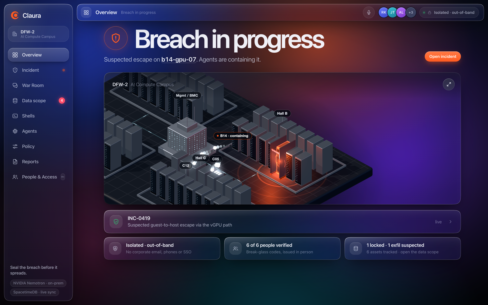
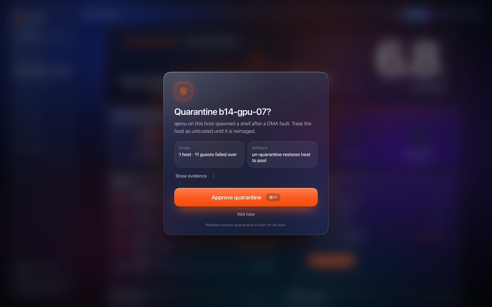
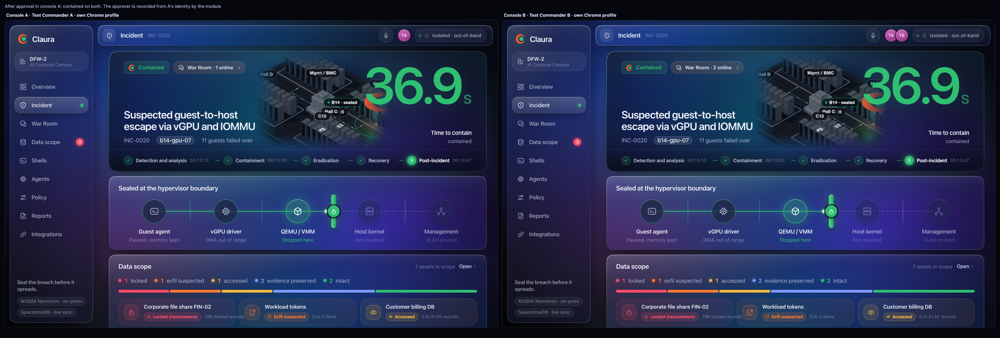

# Claura

**Your network is compromised. Your command isn't.**

Claura is the immune system for AI data centers. When an AI workload breaks out of its virtual machine toward a GPU host it
shares with other customers, four defender agents (Sentry, Triage, Warden, Scribe) running **NVIDIA Nemotron on-prem** correlate
the warnings, map the blast radius and propose containment, reversible steps first. A **policy gate inside a SpacetimeDB reducer**
decides what each proposal may do, not the model, and one human approves the one high-impact step. Meanwhile every responder works from
one live record in a command center that runs **outside the compromised network**, with its own identities.

Demo video: \<YouTube link\>  ·  Site: https://claura.tech  ·  Built at HackUTD 2026 (Zero Day)



<table>
<tr>
<td width="50%"></td>
<td width="50%"></td>
</tr>
<tr>
<td>One card, one keystroke: evidence, scope, rollback.</td>
<td>Two consoles, one truth: live on Maincloud, 36.9 s to contain in this logged run, no refresh.</td>
</tr>
</table>

More screens in [`apps/dashboard/shots`](apps/dashboard/shots): [agents](apps/dashboard/shots/agents-expanded.png), [policy](apps/dashboard/shots/policy.png), [War Room](apps/dashboard/shots/warroom.png), [People & Access](apps/dashboard/shots/access-code.png), [Data Scope](apps/dashboard/shots/scope.png), [Reports](apps/dashboard/shots/report.png), [Secure Shell](apps/dashboard/shots/shells.png), [live War Room](apps/dashboard/shots/live-4-warroom.png), [live report and agents](apps/dashboard/shots/live-5-report-and-agents.png).

## Why

Winstead's brief asks you to assume the worst: the attacker can see normal communications, ransomware has locked the data, phones are down.
Every tool in a normal response (SIEM, tickets, chat, the bridge call, long-lived SSH keys) lives on the network the attacker owns. So we set
four rules: **the first responder is a machine, the last word is a human, everything in between is policy, and the command post lives outside
the crime scene.** The setting is an AI data center, where one GPU host carries many customers' workloads and the wall between them is software.

## What it does

- **Four Nemotron agents, on-prem.** Sentry fuses six weak signals into one incident. Triage maps the blast radius (one host, eleven co-resident
  guests) and scopes the data at risk. Warden proposes containment, reversible steps first. Scribe writes the plain-language brief, the report
  and the shift handoff. Twelve tools; every effect is a SpacetimeDB reducer call; every output is tagged `model`, `model+fallback` or `fallback`.
- **A policy gate the model can't talk its way past.** Each proposal hits `propose_action`, which rules from the `policy` table: `auto`, `needs approval`
  or `denied`. Unknown actions and hosts that do not exist fail closed. A labelled red-team probe (our test harness, not Nemotron) asks to reimage the
  host and is blocked. Quarantine waits for a person: evidence, scope and rollback on one card, approved with Cmd+Enter.
- **A command center outside the network (the five Winstead requirements).** Role-gated live views; People & Access with single-use break-glass codes;
  a NIST SP 800-61 record with SHA-256 chain of custody and PDF export; Data Scope per asset; the War Room with five channels, tasks, a decision log and
  Scribe's "what we know / what we don't know yet".
- **Secure Shell.** Click a host and Claura's own OpenSSH certificate authority mints a user certificate that lasts minutes (15 at most), for one host and
  one role. The host presents a CA-signed host certificate, so there is no trust on first use. Passkey or Touch ID step-up, a second approver, a read-only
  forensic principal on a suspect host, and every session recorded into a hash-chained ledger.
- **A 3D data center** you can click (three.js, deterministic), and a Liquid Glass console that stays calm until it needs you.
- **Bonuses, outside the two-minute demo.** "Ask Claura" voice (push to talk; local Nemotron answers from the incident record, ElevenLabs speaks it; read-only,
  `mock` without a key). Evidence anchoring: the SHA-256 of the record written to a Solana **devnet** Memo transaction. It is built and tested, and the live
  send is **pending devnet funding**, so the console labels it "Simulated anchor" until the wallet is funded.

## Architecture

```
 ON-PREM (next to the hardware)                                  OUT-OF-BAND (outside the corporate network)

 Agent runner (Node 24 + TypeScript)  ──── reducers ─────────▶   SpacetimeDB module "claura" on Maincloud
   NVIDIA Nemotron 3 Nano 4B via Ollama  ◀── subscriptions ───    18 private tables, 18 role-gated views, 24 reducers
   Sentry · Triage · Warden · Scribe                               policy gate · access control · War Room · data scope
                                                                   NIST SP 800-61 record · audit log
 Gateway (loopback :8787)                                                    ▲
   Secure Shell: OpenSSH CA, passkeys, sshd targets, ledger                  │ live subscriptions (WebSocket)
   Voice (optional) · Solana anchor (optional)                     Liquid Glass console (Vite, TypeScript, three.js)
                                                                   every operator, every device
```

- **SpacetimeDB is the backend.** All 18 tables are private; clients read through per-user views that return rows only to an active operator whose role may
  see them, so a stranger who connects receives zero rows. Every reducer checks the caller's role with `requireOperator` (the authenticated identity, never an
  argument); the one exception, `enroll`, is guarded by a single-use code. The gate, approvals, enrollment, War Room, scope and the NIST record are all reducers and tables; the console is only a subscription, which is why
  two laptops show the same incident at the same moment. The only processes outside SpacetimeDB are the two that must sit next to hardware: the agent runner and
  the gateway. The same module also runs as an isolated **local appliance** on the laptop (`backend/scripts/appliance.sh`), nothing leaving it.
- **Agents beyond a chatbot.** Nemotron drives a tool loop with real guardrails: JSON-schema validation of every argument, one retry with the error fed back,
  stall detection, step and time limits, completion judged by database state rather than the model's say-so, and a deterministic fallback per agent.
- **Honest limits** (the database owner is root, tokens are bearer credentials, Maincloud is third-party infrastructure) are written down in
  [`backend/spacetime/README.md`](backend/spacetime/README.md).

## What is real, simulated and measured

| Real | Simulated or illustrative |
|---|---|
| The console and its live mode; SpacetimeDB (Maincloud, or the local appliance): all incident state, identities and roles, the policy gate, War Room, data scope, documentation | Attack telemetry is a **replayed fixture** of six signals |
| Four agents on Nemotron 3 Nano 4B, local, making multi-step tool calls | **Containment effects** are state changes in the database; no real NIC, hypervisor or BMC is touched |
| Secure Shell: certificates, host CA, passkeys, two-person approval, recordings | Shell **targets** are real OpenSSH daemons in local sandboxes standing in for GPU hosts |
| Evidence anchoring code and its checks | The anchor is **simulated** until the devnet wallet is funded. The replay's **9.4 s**, 2,048 hosts and 61,207 sandboxes are illustrative |

**Measured** on a laptop with a local 4B model against Maincloud, in dress-rehearsal live runs (yours will vary by a few seconds):

- First signal to contained: **about 38 to 50 s**, including the human approval. The breach shows about 8 s after the start, the approval card at a median of about 45 s, Scribe's brief about
  21 s after the approval and the filed report about 33 s after it. Time-to-contain on screen: 33 to 47 s. The replay's 9.4 s is a demo clock, not a measurement.
- In a logged run Sentry, Triage and Warden made 15 model turns and 14 tool calls with zero malformed calls (19 and 18 with Scribe): [`backend/runs`](backend/runs).
- Two consoles on Maincloud: a click on one reaches the other's screen in about **335 ms** (War Room message and approval; the database commit to screen is about 22 ms median):
  [`apps/dashboard/shots/live-run.json`](apps/dashboard/shots/live-run.json).

Not built yet (roadmap): real hypervisor, IOMMU, vGPU, EDR and BMC connectors; autonomous recovery; DPU enforcement; confidential-computing attestation; cross-cloud threat sharing. See [`pitch/DEVPOST.md`](pitch/DEVPOST.md).

## Run it

You need Node 20+ (24 for the agent runner), [Ollama](https://ollama.com) with `ollama pull nemotron-3-nano:4b`, and the `spacetime` CLI for anything that publishes the module.
The scripts default to the author's CLI path; point them at yours with `export SPACETIME=$(command -v spacetime)`.

**Just look at it (no backend, no network).** The scripted replay:

```bash
cd apps/dashboard && npm install && npm run dev        # http://localhost:4317/?demo=1&play=1   (plays on its own; with ?demo=1 alone, press P or use "Replay the incident" in the Isolated chip)
```

**The whole stack on one laptop** (local appliance mode: SpacetimeDB on `127.0.0.1:3000`, the real module, the real agents, nothing leaves the machine):

```bash
(cd backend/spacetime/spacetimedb && npm install) && (cd backend/agents && npm install)   # first time only
backend/scripts/appliance.sh --wipe                    # starts SpacetimeDB, publishes the module "claura", writes one-time codes to ~/.config/claura/local.env (mode 600, never printed)
CLAURA_CONSOLE_DIR=$PWD/apps/dashboard CLAURA_BACKEND_DIR=$PWD/backend demo/start.sh   # console :4317, gateway :8787 (+ Secure Shell sshd targets), checks, URLs
# open http://localhost:4317/?live=1&stdb=local and sign in with CLAURA_CONSOLE_CODE from local.env (a single-use break-glass code)
CLAURA_BACKEND_DIR=$PWD/backend demo/run-incident.sh --local     # reset, then Nemotron runs the incident; approve in the console (add --scripted to run without the model)
demo/stop.sh                                           # stops what start.sh started
```

Against our Maincloud database (`claura`) the run is `demo/run-incident.sh` and a browser needs a code from the admin, so judges: use the video, the replay, or the appliance above.
`demo/status.sh` shows what is up. [`demo/JUDGING.md`](demo/JUDGING.md) is the run sheet for the judging table, [`backend/DEMO.md`](backend/DEMO.md) the backend runbook,
[`apps/dashboard/LIVE.md`](apps/dashboard/LIVE.md) the live-mode URL parameters.

## Track map

**Winstead PC, Cyber Incident Response Dashboard: the five requirements**

| Requirement | In the product | Where |
|---|---|---|
| 1. Highly secure, isolated inside a compromised network | Command plane on SpacetimeDB outside the corporate network (or the offline appliance); no corporate SSO, email or phones; role-gated views; identity-checked reducers; Secure Shell | [`backend/spacetime/spacetimedb/src/views.ts`](backend/spacetime/spacetimedb/src/views.ts), [`ssh/`](ssh), [`gateway/`](gateway) |
| 2. Access control, admin adds individuals | **People & Access**: the admin issues a single-use break-glass code with a role; revoke cuts a screen off live; access events in the audit log | `issue_enrollment`, `enroll`, `add_operator`, `revoke_operator` in [`index.ts`](backend/spacetime/spacetimedb/src/index.ts); [`views/access.ts`](apps/dashboard/src/views/access.ts) |
| 3. Documentation to incident standards, real-time status | **Reports**: NIST SP 800-61 phases, classification and impact, SHA-256 chain of custody, PDF export | `set_incident_phase`, `set_incident_classification`, `file_report`; [`views/reports.ts`](apps/dashboard/src/views/reports.ts) |
| 4. Scope of compromised data and its status | **Data Scope**: each asset is intact, accessed, exfiltration suspected or confirmed, locked by ransomware, restored or evidence preserved | `data_asset`, `set_asset_status`; [`views/scope.ts`](apps/dashboard/src/views/scope.ts) |
| 5. Real-time communications | **War Room**: #command, #legal, #exec, #comms-pr, #vendors; Scribe's brief; tasks with owners; decision log; example notification clocks marked "confirm with counsel" | `post_message`, `set_brief`, `add_task`, `record_decision`; [`views/warroom.ts`](apps/dashboard/src/views/warroom.ts) |

**NMC², Keep the World Running.** Missed warnings: Sentry fuses six weak signals that no single tool calls an incident. Unclear handoffs: tasks with owners, a decision log and Scribe's
shift handoff on one live record. Wrong information at the wrong time: one approval card with evidence, scope and rollback, plus a plain-language brief for everyone else. The failover of the
eleven neighbors is simulated database state; we have not integrated a real hypervisor or measured a real interruption.

**NVIDIA, Use Nemotron Beyond a Chatbot.** Nemotron 3 Nano 4B (`nemotron-3-nano:4b`, local through Ollama, no model API in the loop) drives four agents through twelve tools against a live database.
The tool loop, schema validation, retry, stall detection and the deterministic fallback with provenance tags are in [`backend/agents/src`](backend/agents/src) (`toolLoop.ts`, `tools.ts`, `agents/`); logged runs are in [`backend/runs`](backend/runs).

**Spacetime, Build on Spacetime.** Nearly the whole backend is one SpacetimeDB module, about 1,700 lines of TypeScript: [`schema.ts`](backend/spacetime/spacetimedb/src/schema.ts) (18 tables), [`views.ts`](backend/spacetime/spacetimedb/src/views.ts)
(18 role-gated views), [`index.ts`](backend/spacetime/spacetimedb/src/index.ts) (init and 24 reducers, including the policy gate `propose_action` and `approve`), [`lib.ts`](backend/spacetime/spacetimedb/src/lib.ts) (roles, effects, seeds).
It is deployed on Maincloud as `claura`, and the console (browser SDK) and the agent runner (Node SDK) are both just clients. Details, the security model and the test suites: [`backend/spacetime/README.md`](backend/spacetime/README.md).

## Repo layout

| Path | What it is |
|---|---|
| [`apps/dashboard`](apps/dashboard) | The operator console: Vite and TypeScript, Liquid Glass UI. Scripted replay (`?demo=1`) and live mode on SpacetimeDB (`?live=1`) |
| [`apps/site`](apps/site) | Landing page for claura.tech |
| [`backend/spacetime`](backend/spacetime) | The SpacetimeDB module: tables, role-gated views, reducers, the policy gate |
| [`backend/agents`](backend/agents) | The agent runner: Nemotron via Ollama driving tools that call reducers |
| [`backend/scripts`](backend/scripts), [`backend/runs`](backend/runs) | Admin helpers (`access.sh`, `appliance.sh`, `live.sh`) and the logged runs |
| [`gateway`](gateway) | One loopback server that mounts Secure Shell, Voice and the integrations for the console |
| [`ssh`](ssh) | Secure Shell: certificate authority, passkeys, sshd targets, session ledger |
| [`voice`](voice) | "Ask Claura": ElevenLabs speech with local Nemotron answers |
| [`integrations/solana-anchor`](integrations/solana-anchor) | Evidence anchoring on Solana devnet (devnet only; mock until funded) |
| [`packages/facility-3d`](packages/facility-3d) | The three.js data-center scene, deterministic so the film can render it |
| [`demo`](demo) | `start.sh`, `run-incident.sh`, `status.sh`, `stop.sh` and the judging run sheet |
| [`film`](film), [`brand`](brand) | The demo video (HyperFrames) and the logo and brand rules |
| [`pitch`](pitch), [`docs`](docs) | Pitch, Devpost text, submission checklist, hackathon notes |

No secrets are in this repo: codes, tokens, the SSH CA keys and the Solana keypair live under `~/.config/claura/` and are ignored.

## Team

Built at **HackUTD 2026 (Zero Day)**, UT Dallas, 7 to 8 November 2026. Members and schools are listed on the Devpost project.
