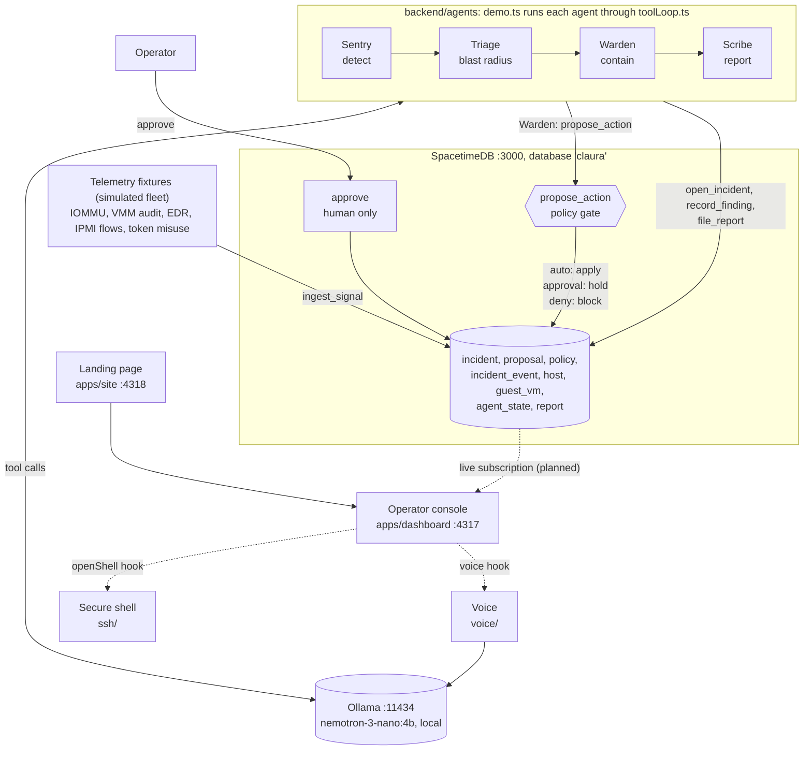
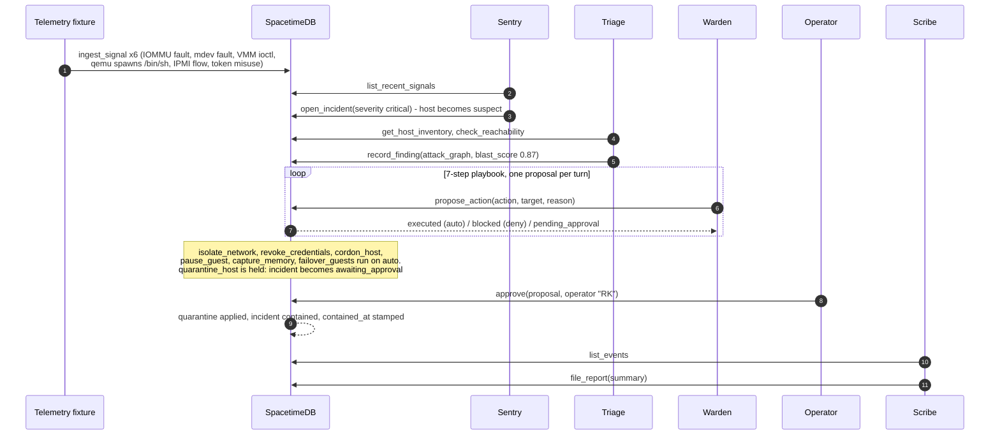
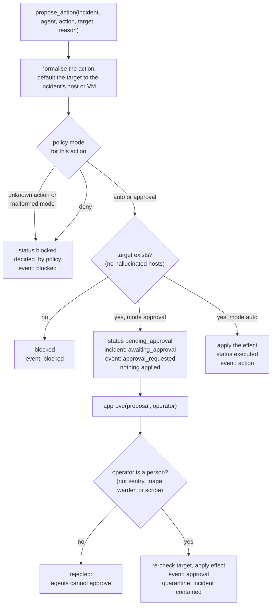
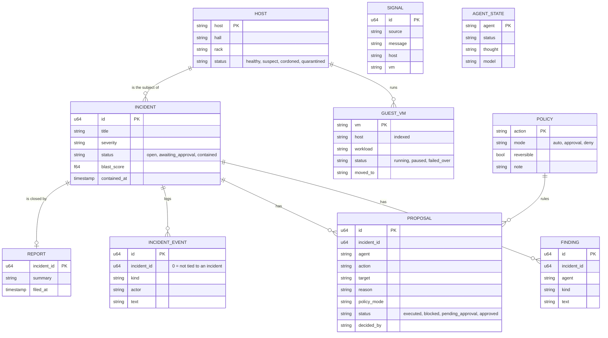
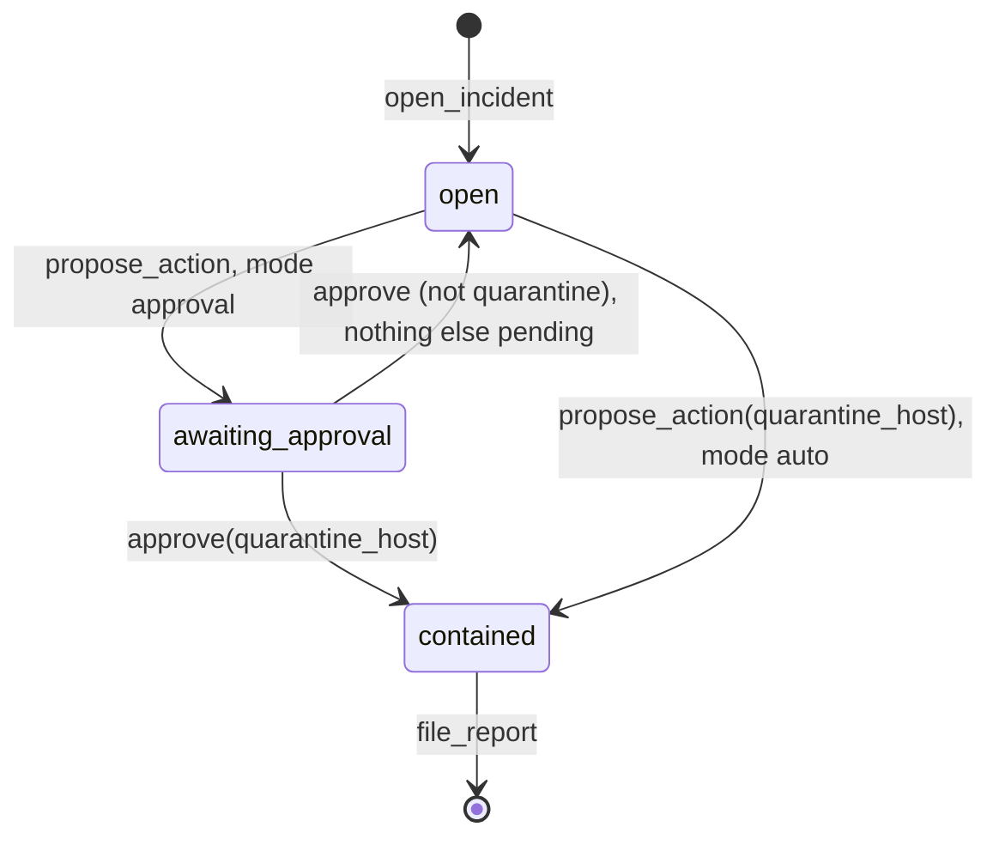

# Claura

**Seal the breach before it spreads.** Claura is incident response for AI data centers. When a sandboxed AI workload
tries to escape its virtual machine, four defender agents (Sentry, Triage, Warden and Scribe) detect it, size what it
could reach and contain it, reversible steps first. Quarantining the host is the one high-impact step, and only a
person can approve it.

Built at HackUTD 2026 ("Zero Day"). Domain: claura.tech.

> **Agents propose, policy decides.** The model never executes anything. Every action it proposes goes through a
> policy gate inside SpacetimeDB, which runs it, blocks it, or holds it for a human.

---

## Contents

1. [What is real and what is demo data](#1-what-is-real-and-what-is-demo-data)
2. [Repository map](#2-repository-map)
3. [System architecture](#3-system-architecture)
4. [The incident, end to end](#4-the-incident-end-to-end)
5. [The policy gate](#5-the-policy-gate)
6. [Data model (SpacetimeDB)](#6-data-model-spacetimedb)
7. [The agents](#7-the-agents)
8. [Operator console](#8-operator-console)
9. [Secure shell and voice](#9-secure-shell-and-voice)
10. [Landing page](#10-landing-page)
11. [Running it](#11-running-it)
12. [Measured timings](#12-measured-timings)
13. [Security model and known limits](#13-security-model-and-known-limits)
14. [Docs, pitch and film](#14-docs-pitch-and-film)

---

## 1. What is real and what is demo data

The attack is simulated. The defense logic runs for real. The table below states each part plainly.

| Part | Status |
|---|---|
| SpacetimeDB module: tables, reducers, policy gate, human approval | **Real.** Runs on a local SpacetimeDB server. |
| Defender agents calling tools in a loop | **Real.** NVIDIA Nemotron 3 Nano 4B, served locally by Ollama, with no cloud calls. Two full live runs are logged in `backend/runs/`. |
| Deterministic fallback when the model fails | Real code. Each agent card says which mode it ran in (`model`, `model+fallback`, `fallback`, `scripted`). |
| Telemetry (the 6 signals of INC-0419) | **Fixture.** Replayed into `ingest_signal` by the runner. |
| Hosts, guests and network reachability | **Seeded.** 13 hosts and 12 guests come from the module's `init`. Reachability is a fixture. |
| Containment effects | **Database only.** `cordon_host`, `pause_guest`, `failover_guests` and `quarantine_host` change rows. `isolate_network`, `revoke_credentials` and `capture_memory` only log an event. Nothing touches real infrastructure. |
| Red-team probe (`reimage_host`, blocked by policy) | **Scripted by the runner** and labelled so. Nemotron never chose a denied action by itself. |
| Operator console (`apps/dashboard`) | **Scripted playback.** It is not connected to SpacetimeDB yet. Its 9.4 s incident is a scripted timeline (see §8). |
| Secure shell (`ssh/`) | Real OpenSSH certificates, passkeys and a hash-chained ledger. The host contents are simulated, and the gateway server is **not in this repo**, so the console cannot open it yet. |
| Voice (`voice/`) | ElevenLabs speech plus local Nemotron answers. The server entry point is **not in this repo** and the console does not load it yet. |
| 3D facility (`packages/facility-3d`) | Real three.js scene. It needs a build and copy step before the console shows it (see §11). |
| Fleet numbers (2,048 hosts, 61,207 agents) | Illustrative. |

---

## 2. Repository map

| Folder | What it is |
|---|---|
| `backend/spacetime` | SpacetimeDB module (TypeScript): incident state, the policy gate, the live incident log |
| `backend/agents` | The four defender agents, the tool loop, the Ollama client, the demo runner and tests |
| `backend/runs` | Logs and database dumps from real runs (live Nemotron, scripted, policy flip) |
| `apps/dashboard` | Operator console (Vite + TypeScript, no framework). Scripted incident playback |
| `apps/site` | Landing page for claura.tech (Vite + TypeScript) |
| `packages/facility-3d` | three.js data center scene, deterministic so the film can render it |
| `ssh` | Claura Secure Shell: just-in-time certificate access, passkey step-up, two-person approval, hash-chained ledger |
| `voice` | Voice briefings and spoken Q&A (ElevenLabs + local Nemotron) |
| `brand` | Logo (the "Cradle" mark), app icon, brand rules (`brand/BRAND.md`) |
| `film` | Demo video project (HyperFrames). Not rendered yet |
| `pitch` | Pitch drafts and a simulated judge panel review |
| `docs` | Devpost write-up, pitch script, hackathon research, video notes, [demo flow](docs/DEMO-FLOW.md) |
| `tools` | `sync.sh` and `push.mjs` (see the warning in §11) |

---

## 3. System architecture

Solid lines run today. Dashed lines are designed, with hooks in the code, but not connected yet.



What each piece owns:

- **SpacetimeDB is the referee.** All incident state lives in one module. Reducers are the only way to change it, and
  the policy gate is a reducer. So an action the policy refuses never runs, whatever the model says.
- **Agents never hold state.** They read through tools and write through reducers. Incident IDs are bound inside the
  tools, so the model never has to carry one.
- **Every agent checks "done" against the database.** A loop ends when the backend shows the work was done, not when
  the model says it finished.

---

## 4. The incident, end to end

INC-0419: a sandboxed agent (`agent-7f3` in `vm-7f3a`) escapes through the vGPU path on host `b14-gpu-07`, Hall B,
rack 14. Eleven other guests share the host.



The runner also sends one `propose_action(reimage_host)` as a red-team probe. The policy blocks it, which shows that
a destructive action cannot run even when an agent asks for it.

---

## 5. The policy gate

`propose_action` in `backend/spacetime/spacetimedb/src/index.ts` is the gate. The rule that an agent cannot quarantine
a host is **data**: the seeded `policy` row says `quarantine_host = approval`. Changing the row changes the behaviour,
with no code change.



Seeded policy:

| Mode | Actions |
|---|---|
| `auto` (reversible, runs at once) | `isolate_network`, `revoke_credentials`, `cordon_host`, `pause_guest`, `capture_memory`, `failover_guests` |
| `approval` (held for a person) | `quarantine_host` |
| `deny` (never runs) | `reimage_host`, `power_off_hall`, `delete_vm` |

---

## 6. Data model (SpacetimeDB)

All tables are public, so agents and consoles can subscribe to them.



Reducers: `reset_demo`, `ingest_signal`, `open_incident`, `set_agent_state`, `record_finding`, `propose_action`,
`approve`, `set_policy`, `file_report`. An `init` hook seeds the database on first publish. There are no scheduled
reducers; nothing in the module runs on a timer.

Incident status moves like this:



Host status only moves forward: healthy, then suspect, then cordoned, then quarantined. `cordon_host` never
downgrades a quarantined host.

---

## 7. The agents

`backend/agents/src/demo.ts` runs a fixed pipeline: `reset_demo`, replay telemetry, Sentry, Triage, Warden, the
red-team probe, wait for a human, then Scribe. Each agent updates its `agent_state` row (status, live thought, model)
as it works, so a console can show it.

| Agent | Tools | Writes | Done when the database shows | Limits |
|---|---|---|---|---|
| Sentry | `list_recent_signals`, `open_incident` | `open_incident` | an open incident | 5 steps, 6 calls, 60 s |
| Triage | `get_host_inventory`, `check_reachability`, `record_finding` | `record_finding` with `blast_score` | an `attack_graph` finding | 6 steps, 8 calls, 90 s |
| Warden | `get_policy`, `propose_action` | `propose_action` | all 7 playbook steps ruled on | 14 steps, 16 calls, 150 s |
| Scribe | `list_events`, `file_report` | `file_report` | a report row | 5 steps, 6 calls, 90 s |

**The tool loop** (`toolLoop.ts`):

1. Call Ollama with the tool specs. A transient error gets one retry after 400 ms.
2. Validate each tool call against its schema (`schema.ts`). Errors go back to the model as tool results instead of
   being thrown.
3. A repeated identical call is answered with a "duplicate" notice instead of running again. Three stalls end the
   loop.
4. If the model stops early, try to salvage its prose (for example, Scribe writing the report as chat text), then
   nudge it up to two times.
5. The loop never throws. It returns an outcome: `done`, `max_steps`, `max_tool_calls`, `no_tool_calls`, `malformed`,
   `llm_error`, `deadline` or `stalled`.
6. Any outcome other than `done` falls back to the agent's deterministic routine. That routine does only the missing
   work, and the agent card is marked `deterministic fallback (no model output used)`.

**Model settings** (`ollama.ts`): `nemotron-3-nano:4b`, temperature 0, seed 7, `num_ctx` 8192, `think: false`,
`keep_alive` 30 m. A preflight checks the model is installed and runs one warm-up call.

---

## 8. Operator console

`apps/dashboard` is a scripted playback of INC-0419 with the full operator experience. One `requestAnimationFrame`
clock drives every view through pure functions in `engine.ts`. All timings live in `script.ts`.

**Views:**

| View | What it shows |
|---|---|
| Overview | Fleet status, a 2D hall map (3D if built), last incident |
| Incident | The live incident: hypervisor-boundary path, agents, the 7 containment steps, signals, evidence, blast radius |
| War Room | Out-of-band channel: stakeholder brief, `#command`, `#legal`, `#exec`, `#comms-pr`, `#vendors`, tasks, decisions, notification clocks |
| Shells | Slot for the secure shell (`#claura-shell-slot`) |
| Agents | Each agent's thoughts, tool calls and bounds |
| Policy | Presets plus auto and human-only actions (UI only) |
| Reports | INC-0419 report (15 entries) and past incidents |

**Scripted timeline** (`script.ts`):

| T+ | Event |
|---|---|
| 0.0 – 0.85 s | Six signals arrive |
| 1.0 s | Sentry opens INC-0419 |
| 1.8 s | Triage scores the blast radius at 0.87 |
| 2.0 – 5.3 s | Warden's six reversible steps |
| 5.5 s | Approval requested: quarantine `b14-gpu-07` |
| 7.4 s | Canonical approval (⌘↵) |
| 9.4 s | Contained |
| 12.4 s | Scribe files the report |

**URL parameters** (for demos, screenshots and the film):

| Parameter | Effect |
|---|---|
| `demo=1` | Hides the dev dock ("Simulate breach", "Reset") |
| `view=overview\|incident\|warroom\|shells\|agents\|policy\|reports` | Opens a view |
| `phase=breach\|approval\|contained\|report` | Jumps to a phase |
| `t=<seconds>` | Seeks the incident clock |
| `play=1&approveAt=7.4` | Plays, approving automatically at the given time |
| `expand=signals,evidence,agent:warden,…` | Opens disclosures |
| `channel=exec` | Selects a War Room channel |
| `host=b14-gpu-07` | Opens the host sheet |

Keys: ⌘↵ or Ctrl↵ approves, Esc closes a sheet. `window.claura` exposes `play`, `seek`, `approve`, `go`,
`openHost`, `targets()` and more for scripted capture.

**Integration hooks, not wired yet:**

| Hook | Expected from |
|---|---|
| `window.claura.openShell(hostId)` and `#claura-shell-slot` | The secure shell gateway |
| `window.claura.voice.toggle()` / `.playBrief()` | `voice/ui.js`, with `/api/voice` on the same origin |
| `/bulkhead-3d/facility.js` exporting `createFacility` | `packages/facility-3d` build output |
| A SpacetimeDB subscription | Not written. Bindings already exist in `backend/agents/src/module_bindings` |

---

## 9. Secure shell and voice

**Secure shell (`ssh/`).** Just-in-time access to a suspect host without trusting the network:

- An SSH certificate authority (ed25519, via `ssh-keygen`) issues certificates that live at most 15 minutes.
- One user-space `sshd` per host on `127.0.0.1` (ports from 2201) accepts only those certificates. Its forced
  command is a simulated host shell with canned logs and files.
- Hosts under incident need a passkey step-up (WebAuthn, Touch ID) and two approvals, never from the requester.
  The session is read-only forensics.
- Sessions are recorded as asciicast. Every request, approval and session goes into an append-only JSONL ledger,
  where each entry hashes the previous one, so tampering is visible on startup.

Missing from this repo: the HTTP/WebSocket route layer (`dev.mjs`) and the browser terminal that mounts into the
console.

**Voice (`voice/`).** It mounts on an Express 5 app under `/api/voice`:

- Endpoints: `/status`, `/tts`, `/stt`, `/ask`, `/brief`, `/sting`.
- ElevenLabs handles speech to text and text to speech. Local Nemotron answers questions about the incident in at
  most two sentences, and orders such as "approve the quarantine" are refused before any model call.
- Briefs come in English, Spanish, Hindi, Chinese and French.
- Without an `ELEVENLABS_API_KEY` it runs in mock mode, and the browser falls back to built-in speech.

Missing from this repo: the server entry point (`dev.mjs`) and the step that loads `ui.js` into the console.

---

## 10. Landing page

`apps/site` is the claura.tech page:

- A dithered floor plan of the four halls with a scrubber that replays INC-0419.
- The four agents, a working approval card (⌘↵), the timeline, and the architecture diagram.
- Light and dark themes.

The incident data comes from one file (`src/incident.ts`). "Open the console" points at `http://localhost:4317/?demo=1`
(`src/main.ts`), so change it before deploying.

---

## 11. Running it

### Prerequisites

- Node 24 or later (the SpacetimeDB SDK needs it).
- The `spacetime` CLI. It defaults to the cloud, so always pass `--server local`.
- Ollama with the model pulled: `ollama pull nemotron-3-nano:4b`.

### Backend: module and agents

```bash
# 1. SpacetimeDB module
cd backend/spacetime && (cd spacetimedb && npm install)
spacetime start &                                  # local server on 127.0.0.1:3000
spacetime publish --server local claura --yes      # first publish seeds itself through init
spacetime sql --server local claura "SELECT * FROM policy"

# 2. Agents
cd ../agents && npm install
npm run demo                              # live Nemotron; waits for a human to approve
npm run demo -- --auto-approve-after 3    # approves as RK after 3 s
npm run demo -- --scripted                # no model, same reducers, canned text
npm run demo -- --mem --scripted          # no model, no database
npm test                                  # unit tests on the in-memory mirror

# Approve by hand while the runner waits (find the id in the proposal table)
spacetime call --server local claura approve <proposal_id> '"RK"'
```

After any schema or reducer change, regenerate the bindings:

```bash
spacetime generate --lang typescript --import-extension ts -y \
  --module-path backend/spacetime/spacetimedb --out-dir backend/agents/src/module_bindings
```

`npm run demo` calls `reset_demo`, which wipes the `claura` database. Pass `--no-reset` to keep it.

| Variable | Default |
|---|---|
| `OLLAMA_URL` | `http://localhost:11434` |
| `OLLAMA_MODEL` | `nemotron-3-nano:4b` |
| `STDB_URI` | `ws://127.0.0.1:3000` |
| `STDB_DB` | `claura` |

Runner flags: `--scripted`, `--mem`, `--auto-approve-after N`, `--approval-timeout S`, `--red-team auto|off`,
`--telemetry-speed X`, `--pace-ms N`, `--llm-timeout S`, `--no-reset`, `-v`.

### Console and landing page

```bash
cd apps/dashboard && npm install && npm run dev   # http://localhost:4317/?demo=1
cd apps/site && npm install && npm run dev        # http://localhost:4318
```

Both pages load Geist from Google Fonts. Without internet they fall back to system fonts.

### 3D facility in the console

```bash
cd packages/facility-3d && npm install && npm run build
mkdir -p ../../apps/dashboard/public/bulkhead-3d
cp dist/facility.js ../../apps/dashboard/public/bulkhead-3d/
```

Without this step the console silently shows the 2D map.

### `tools/` warning

`npm run push` (root) stages **everything**, commits it with a fixed co-author line and pushes to
`zero-abd/claura` `main` using your `gh` login. `tools/sync.sh` rsyncs with `--delete` from `~/repos/*`. Check
`git status` before using either.

---

## 12. Measured timings

| Run | First signal to approval card | To contained | Report filed after containment |
|---|---|---|---|
| Console (scripted playback) | 5.5 s | 9.4 s (approval at 7.4 s) | 3.0 s |
| `--scripted` runner (no model) | 6.4 s | 9.5 s | 0.9 s |
| Live Nemotron, agents README | about 31 s | about 34 s | about 10 s |
| Live Nemotron, `runs/live-run-2` | 57.2 s | 60.8 s | 10.1 s |
| Live Nemotron, `runs/live-run-1` | 75.4 s | 79.3 s | 11.7 s |

Warden takes the longest live: 8 turns with one proposal per turn, 31–47 s of model time. In both logged runs all four agents finished on the model, with no bad tool calls and no fallback. The live runs auto-approved
3 s after the approval request. When presenting, say which number you show: 9.4 s is the scripted demo, while a real
model run takes 30–80 s on a laptop.

---

## 13. Security model and known limits

**What the design guarantees:**

- The model cannot execute anything. It can only call `propose_action`.
- Unknown actions and malformed policy fail closed (deny).
- Targets are checked, so a hallucinated host or VM is blocked.
- An agent name cannot approve. Approval needs a named operator.
- The incident log is append-only and written by reducers, not by the model.

**Known limits:**

- **No authentication on reducers yet.** `approve` checks the operator name, not `ctx.sender`. Any client can call
  `approve` with a person's name, or flip `quarantine_host` to `auto` with `set_policy`. The gate protects against
  the model, not against a hostile API client. Next step: bind operator identities and restrict `set_policy`.
- There is no `reject` reducer and no separate data-scope view (locked, accessed, exfiltrated).
- Telemetry is a fixture, and containment effects only change rows.
- The red-team probe is scripted, not chosen by the model.
- Prompt injection through log text: signals reach the model as tool results, and the gate limits the damage to
  proposals. Its policy still decides.
- The ledger hash chain makes tampering visible. It is not a full chain of custody (no signatures, no external
  anchor).

---

## 14. Docs, pitch and film

| File | What it is |
|---|---|
| [`docs/DEMO-FLOW.md`](docs/DEMO-FLOW.md) | Recommended table-demo flow, setup checklist, fallbacks and judge Q&A |
| `docs/HACKATHON.md` | Event facts, tracks, sponsor requirements |
| `docs/PITCH.md`, `docs/DEVPOST.md` | Pitch script and Devpost text (written before the backend landed; update before submitting) |
| `pitch/drafts/`, `pitch/panel/round1-final.md` | Four pitch angles and a simulated 8-judge review |
| `film/` | Demo video project. Not rendered; its placeholder stills show the old console look |
| `brand/BRAND.md` | Logo geometry and colour rules |
